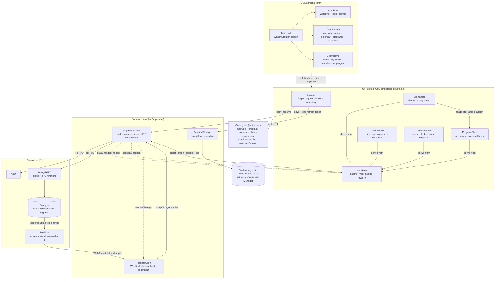
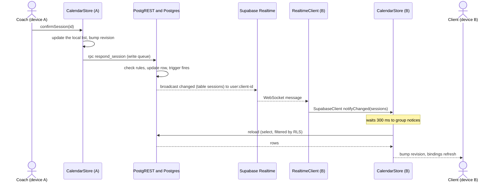

# Aura

A coaching app for personal trainers and their clients, built with **Qt 6 / QML**.
Coaches manage clients, build training programs, assign them, and run their
calendar. Clients find a coach, follow their program week by week, and book
sessions in the coach's free time.

One app, two roles: after login the app opens the **coach app** or the
**client app** depending on the account.

> **Status: on the backend (Phase 2).** Accounts, programs, the exercise library,
> clients, coaching requests, invitations and the calendar all use real Supabase
> data (an internet connection is needed), with live updates between devices, and
> the app stays logged in between launches. Only parts of the two dashboards are
> still sample content. See [Roadmap](#roadmap).

---

## Run it

Requirements: **Qt 6.10+** (developed on **Qt 6.12.0**) with the **Qt WebSockets**
add-on (Maintenance Tool → Qt 6.12.0 → Additional Libraries), CMake 3.16+, Ninja.
Runs on **macOS** and **Windows** (MinGW kit). The first CMake configure
downloads QtKeychain (saved login), so it needs an internet connection.

**Qt Creator:** open `CMakeLists.txt`, pick the Qt 6.12 kit, press Run.

**Command line (macOS, Qt installed in `~/Qt`):**

```bash
export PATH=$HOME/Qt/Tools/CMake/CMake.app/Contents/bin:$HOME/Qt/Tools/Ninja:$PATH
cmake -S . -B build/dev -G Ninja -DCMAKE_PREFIX_PATH=$HOME/Qt/6.12.0/macos
cmake --build build/dev
open build/dev/appqt_aura.app

# QML linter (should print no warnings)
cmake --build build/dev --target all_qmllint
```

**Command line (Windows, Git Bash, Qt installed in `C:\Qt`):**

```bash
export PATH=/c/Qt/Tools/CMake_64/bin:/c/Qt/Tools/Ninja:/c/Qt/Tools/mingw1310_64/bin:/c/Qt/6.12.0/mingw_64/bin:$PATH
cmake -S . -B build/dev -G Ninja -DCMAKE_PREFIX_PATH=C:/Qt/6.12.0/mingw_64
cmake --build build/dev
./build/dev/appqt_aura.exe

# QML linter (should print no warnings)
cmake --build build/dev --target all_qmllint
```

Working on both machines: commit and push on one, `git pull` on the other.
Qt Creator's files (`build/`, `.qtcreator/`) are per machine and not in git.

The window opens at 1920×1080, or smaller to fit the screen.

### Demo accounts

| Role | Email | Password | Who |
|---|---|---|---|
| Coach | `coach@aura.app` | `password` | Giulia Rossi |
| Client | `client@aura.app` | `password` | Luca Bianchi (one of Giulia's clients) |

Every account in the demo data uses the password `password` (other coaches and
clients: `<first>.<last>@example.com`). Accounts created with **Sign up** are
real and stay in the database, like every change you make. Changes show up
live in other open apps: run two copies, one as the coach and one as a client,
to see it. Useful ways to try things:

- **Coach requests:** sign up a new client, request Giulia from **My coach**,
  then log in as the coach → **Clients** → **Accept clients**.
- **Invitations:** as the coach, switch to **Private profile**, invite an email,
  then sign up with that email. `laura.ricci@example.com` already has an invitation.
- **Bookings:** as Luca, open **Calendar** and drag over free slots. Then, as the
  coach, open **Calendar** and click the amber request.

---

## What's in it

### Coach app

| Section | What it does |
|---|---|
| **Dashboard** | Today's numbers, today's sessions, clients to follow up (partly sample data) |
| **Clients** | Client list with program status (active, ending soon, **expired**, scheduled), filters, search. Public/private profile: **Accept clients** (requests from the directory) or **Invite client** (by email). Client page: current program, extend / end / change, history, contact details, "Open program →" |
| **Calendar** | Week view in 30-minute slots. Click or drag to block slots, block or free a whole day, **Edit working hours** (several ranges per day). Client booking requests in amber: click any session to see its details and confirm, decline or cancel |
| **Programs** | Program list and editor: days, exercises, sets / reps / load / rest / notes, and **per-week changes** (deloads, test weeks) |
| **Exercises** | Exercise library: search, filter by muscle group, create and edit exercises |
| Messages | Placeholder |

Badges in the menu: **Clients**: green = coaching requests, red = expired
programs. **Calendar**: green = booking requests.

### Client app

| Section | What it does |
|---|---|
| **Home** | Next session, current program, goals (partly sample data) |
| **My coach** | No coach: coach directory (search, online / in person) and request a coach. Invited: accept or decline. Has a coach: profile, hours, contact, next session, program, stop coaching |
| **Calendar** | The coach's week in 30-minute slots (free / unavailable). Click or drag to choose start and length (up to 3 h), then request it. The session is pending until the coach confirms. Cancelling is allowed up to 24 h before the start |
| **My program** | The assigned program, read-only, on the current week, with that week's values. Tap an exercise for notes and instructions |
| Progress, Messages | Placeholders |

Every screen has a desktop layout (sidebar) and a phone layout (bottom tab bar),
plus light and dark themes.

---

## Project structure

```
CMakeLists.txt          Qt 6 CMake project; every QML file must be listed in QML_FILES
main.cpp                Creates the Supabase client, loads the QML module "qt_aura"
Main.qml                Window + router: auth flow / coach app / client app
src/                    C++ (Phase 2)
  supabase/               SupabaseClient: auth, token refresh, tables, RPC calls;
                          RealtimeClient: live updates (Supabase Realtime)
  models/                 value types QML reads (AuraUser, …)
  stores/                 C++ stores, QML singletons: Session (login / signup / logout),
                          ProgramStore (programs, exercise library), ClientStore
                          (clients, assignments), CoachStore (directory, requests,
                          invitations, visibility), CalendarStore (hours, blocked
                          slots, sessions, bookings); StoreBase (what they share)
supabase/               Database: migrations/ (schema, rules, RLS) and seed.sql (demo data)
qml/
  theme/Theme.qml       Design tokens (colors, radii, font sizes), light/dark
  services/MockData.qml  leftover sample content for the dashboards
  components/           Reusable controls (AuraButton, AuraDialog, Card, Chip, AppShell, …)
  screens/
    auth/                 welcome, login, signup
    coach/                CoachHome + dashboard, clients/, calendar/, programs/
    client/               ClientHome + dashboard, coach/, calendar/, program/
importedcontent/        Qt Creator's Figma import folder (unused)
```

### Architecture in one paragraph

QML screens never hold data of their own. They call **store singletons**, C++
classes in `src/stores/` that load the signed-in user's data from Supabase and
own the business rules (program status, free slots, booking states, …).
Changes show up at once and go to the server in order; the database enforces
the same rules again (row-level security and SQL functions). All styling comes from `Theme`, and all controls use
`QtQuick.Controls.Basic` with custom looks.

### Architecture diagram

Solid arrows are calls, dotted arrows are signals.



### How a change reaches another device

Here the coach confirms a booking and the client's app updates. No row data
goes through Realtime: the notice only names the table, and the client reloads
it through the API, so row-level security still decides what it can see.



---

## Roadmap

| Phase | What | Status |
|---|---|---|
| 0 | Scope and design every screen in QML, with sample data | **Mostly done.** Messages and Progress are still to design |
| 1 | Backend: Supabase (Postgres) in an EU region, row-level security, auth, migrations in git | **Done.** Schema, rules and demo data in `supabase/` |
| 2 | Qt ↔ backend: C++ `SupabaseClient` (HTTPS / JSON / tokens), replace stores with C++; QtKeychain later | **Mostly done.** All stores are C++ on Supabase, live updates (Realtime), stay logged in (QtKeychain). Left: unit tests |
| 3 | Remaining core features on real data (messages, progress, session notes) | Not started |
| 4 | Offline: SQLite cache, sync queue | Not started |
| 5 | Desktop release: packaging, code signing, CI installers | Not started |
| 6 | iOS / Android builds, push notifications | Not started. Phone layouts already exist |

**Before Phase 6:** Qt is LGPL. On iOS, apps are statically linked, which makes
LGPL compliance awkward, so decide on a Qt commercial license first.

**Data protection:** client data includes health data (a special category under
GDPR). Plan consent, data export and deletion into Phase 1.

### Database tables

profiles (every account) · coach_profiles (public profile, visibility) ·
coachings (requests, invitations, active and past coach–client links) ·
assignments · programs · program_days · program_entries (with per-week
changes) · exercises (built-in + each coach's own) · working_hours ·
blocked_slots · sessions (status, who cancelled). See `supabase/migrations/`.
